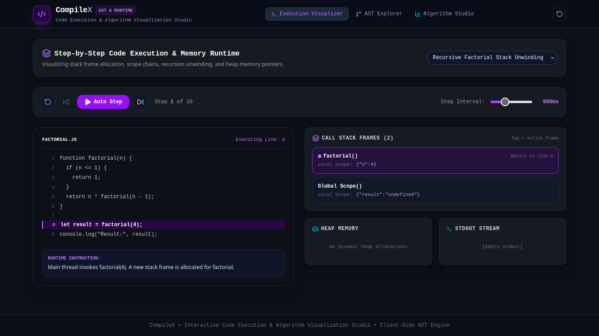

# CompileX — Interactive Code Execution & Algorithm Visualization Studio

[](https://react.dev)
[](https://www.typescriptlang.org/)
[](https://vitejs.dev/)
[](https://tailwindcss.com/)
[](https://vitest.dev/)

**CompileX** is a developer education studio that visualizes code execution, variable states, memory structures, algorithm behavior, and abstract syntax trees (AST) in real time. It allows students to observe step-by-step how functions push and pop onto the call stack, how recursion unwinds, how pointers mutate in memory, and how sorting algorithms partition arrays.

---

## Visualizer Preview



---

## 1. Problem Statement

When learning programming, data structures, algorithms, and compiler concepts, students struggle to mentalize the internal execution process:
- **Call Stack Opacity:** How activation records (stack frames) are allocated, parameter bindings are passed, and frames unwind upon function return.
- **Lexical & Syntactic Abstraction:** How raw source code is converted into lexical tokens and parsed into an Abstract Syntax Tree (AST).
- **Static Algorithm Tracing:** Traditional textbooks present algorithm step sequences through static tables rather than dynamic visual comparisons and mutations.

---

## 2. Core Capabilities

### A. Step-by-Step Code Execution & Memory Runtime
- Highlights the current executing code line synchronously with runtime state.
- Interactive playback controls: `Step Forward`, `Step Backward`, `Auto Step (Play/Pause)`, `Reset`, and speed slider.
- Built-in runtime execution presets:
  - **Recursive Factorial:** Visualizes call stack frame push, base case condition evaluation ($n \le 1$), and multiplication during frame unwinding.
  - **Iterative Binary Search:** Visualizes array pointer convergence (`low`, `mid`, `high`) searching for targets on a sorted dataset.
- Real-time **Call Stack Inspector** displaying function names, local variable scopes, and return line pointers.
- **Heap Memory Panel** tracking dynamic array and object references (`ref@0x01`).
- Virtual **Standard Output Stream (`stdout`)** capturing `console.log` output.

### B. Lexical Tokenizer & AST Explorer
- Live lexical scanner breaking source code into color-coded token badges: Keywords, Identifiers, Numbers, Strings, Operators, and Punctuation.
- Hierarchical recursive **Abstract Syntax Tree (AST)** visualization with expandable and collapsible branch nodes (`Program` $\rightarrow$ `FunctionDeclaration` $\rightarrow$ `BlockStatement` $\rightarrow$ `IfStatement` $\rightarrow$ `ReturnStatement`).
- Live re-parsing of custom user input in the editor.

### C. Algorithm Studio & Complexity Analyzer
- Step-by-step visualization for fundamental algorithms:
  - **Bubble Sort:** Adjacent element comparisons and bubble-up swaps.
  - **Selection Sort:** Linear scanning for minimum element and placement into sorted prefix.
  - **Insertion Sort:** Key element selection and right-shifting of larger elements.
  - **Quick Sort:** Pivot selection and two-way partitioning around the pivot.
- Visual array bars color-coded by state: Comparing (amber), Swapping (rose), Pivot (purple), Sorted (emerald).
- Operation counters tracking **Total Comparisons** and **Total Swaps / Shifts**.
- Theoretical Complexity HUD providing **Best**, **Average**, and **Worst-case Time Complexities** alongside auxiliary **Space Complexity**.
- 1-click **Randomize Array** utility.

---

## 3. Architecture & File Structure

```text
compilex/
├── src/
│   ├── components/
│   │   ├── algorithms/
│   │   │   └── AlgorithmStudio.tsx      # Array bars & sorting visualizer
│   │   ├── ast/
│   │   │   └── ASTExplorer.tsx          # Token stream & recursive AST tree
│   │   ├── layout/
│   │   │   └── Navbar.tsx               # Studio navigation & reset
│   │   └── visualizer/
│   │       └── ExecutionVisualizer.tsx  # Code editor, call stack & heap
│   ├── engine/
│   │   ├── algorithms.ts                # Step generators for sorting algorithms
│   │   ├── compilex.test.ts             # Vitest unit test suite
│   │   ├── parser.ts                    # Lexer tokenizer & AST builder
│   │   └── runtime.ts                   # Step-by-step execution presets
│   ├── store/
│   │   └── useCompileXStore.ts          # Zustand store
│   ├── types/
│   │   └── index.ts                     # Strict TypeScript interfaces
│   ├── App.tsx
│   ├── main.tsx
│   └── index.css
├── docs/
│   └── screenshots/
│       └── dashboard.png
├── package.json
├── vite.config.ts
├── tsconfig.json
└── README.md
```

---

## 4. Setup & Running Locally

```bash
# Clone and enter directory
cd compilex

# Install dependencies
pnpm install

# Run development server
pnpm dev

# Run Vitest test suite
pnpm test

# Build for production
pnpm build
```

---

## 5. Verification & Testing

Unit tests in `src/engine/compilex.test.ts` verify:
1. Lexical tokenizer correctly categorizes keywords, identifiers, and operators.
2. Abstract Syntax Tree (AST) builder constructs valid hierarchical syntax nodes.
3. Bubble Sort generates mathematically accurate step-by-step array state transitions.
4. Recursive Factorial runtime preset allocates and unwinds activation frames properly.
